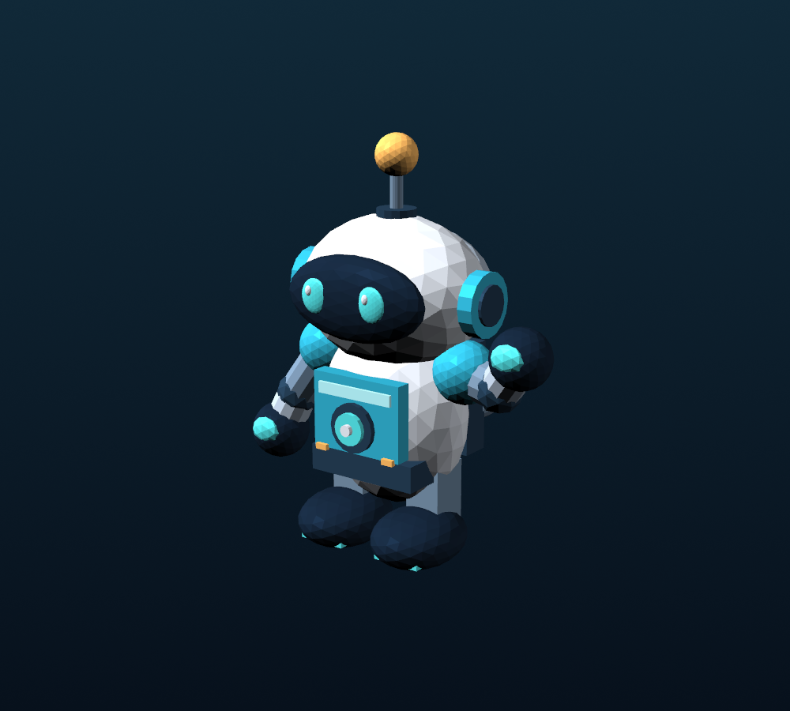

# Лабораторная работа № 4 — маркерная дополненная реальность

**Технологии:** A-Frame 1.6.0, AR.js 3.4.7, WebGL, WebRTC (камера), glTF 2.0.  
**Проект:** 3D-робот ASTROBOT появляется над маркером, движется вместе с ним и скрывается, когда маркер исчезает из кадра.



## 1. Что уже реализовано

- Написана AR-страница `index.html` с распознаванием локального маркера через `AR.js`.
- Сделан оригинальный цветной 3D-робот (46 частей), экспортированный в **настоящие файлы** `astrabot.glb` и `astrabot.gltf`.
- Файл `marker/hiro_local.patt` содержит обученный ARToolKit-шаблон **именно для картинки `marker/hiro.png`**. Это основной, рекомендуемый вариант: маркер и шаблон согласованы.
- Модель привязана к координатной системе маркера и мягко вращается / слегка покачивается над ним.
- Показывается статус: загрузка, поиск маркера, найден, потерян.
- Дополнительно создана страница `hiro_preset.html` с *официальным* способом `<a-marker preset="hiro">`, как в задании.
- Добавлены страница просмотра 3D-модели без камеры, сервер для Windows/PyCharm и маркер для печати на А4.

## 2. Как посмотреть готовую работу на ТЕЛЕФОНЕ

**Важно:** для камеры в мобильном браузере сайт должен быть открыт через **HTTPS**. Локальный адрес `http://192.168.x.x:8000` для телефона не подходит: современные браузеры обычно не дают доступ к камере по обычному HTTP. Самый простой бесплатный вариант — GitHub Pages.

### Выложить сайт на GitHub Pages

1. Создайте репозиторий на [github.com](https://github.com) (например, `lr4-arjs`). Репозиторий сделайте **Public**.
2. Загрузите **содержимое** папки `LR4_ARJS_Kodirov` в корень репозитория. В корне должен лежать файл `index.html`, а рядом — папки `assets`, `marker` и остальные файлы. Не загружайте одну вложенную папку `LR4_ARJS_Kodirov`, иначе главная страница не откроется по корневому адресу.
3. Откройте **Settings → Pages → Build and deployment**. Выберите **Deploy from a branch**, ветку **main**, папку **/(root)**, затем сохраните.
4. Откройте опубликованный адрес вида:

   `https://ВАШ_ЛОГИН.github.io/lr4-arjs/`

5. Откройте эту ссылку **в Chrome на Android** или **Safari на iPhone** и разрешите доступ к камере.
6. На **другом устройстве** (например, на экране компьютера) откройте `marker/hiro.png` из архива, либо распечатайте `marker/hiro_print_A4.pdf`.
7. Наведите телефон так, чтобы черная квадратная рамка маркера целиком попадала в кадр. Над ним должен появиться **робот на платформе**. Поверните лист/экран: робот продолжит следовать за маркером. Уберите маркер из кадра: модель пропадет.

**Внимание к двум режимам:**

| Страница | Какой маркер показывать | Что используется в коде |
|---|---|---|
| `index.html` (рекомендуется) | `marker/hiro.png` из архива или PDF `marker/hiro_print_A4.pdf` | `a-marker type="pattern" url="./marker/hiro_local.patt"` |
| `hiro_preset.html` (официальный пример) | [Официальный HIRO](https://raw.githubusercontent.com/AR-js-org/AR.js/master/data/images/hiro.png), **не** картинка из архива | `a-marker preset="hiro"` |

Локальная картинка в архиве выполнена по схеме классического HIRO и специально согласована с файлом `.patt`; для режима `preset="hiro"` откройте именно оригинал по ссылке.

## 3. Как запустить на КОМПЬЮТЕРЕ в Windows / PyCharm

Нужен установленный Python 3. Никаких `pip install` для запуска сайта не требуется.

**Способ A — двойным щелчком:** запустите `run_local.bat` и не закрывайте окно сервера.

**Способ B — терминал PyCharm:** откройте папку проекта и выполните:

```powershell
python serve.py
```

Затем в браузере откройте:

- **AR c веб-камерой:** http://localhost:8000/
- **Просмотр модели без камеры:** http://localhost:8000/preview.html
- **Официальный режим HIRO:** http://localhost:8000/hiro_preset.html
- **Изображение маркера:** http://localhost:8000/marker/hiro.png

Для прекращения работы сервера нажмите `Ctrl+C` в окне терминала.

**Почему нельзя просто открыть `index.html` двойным щелчком?** Путь `file://...` не является нормальным веб-сервером; загрузка `.glb` и доступ к камере могут блокироваться политиками браузера. На ПК `http://localhost:8000` считается безопасным контекстом, на телефоне для удаленного сайта нужен HTTPS.

## 4. Где находятся файлы 3D-модели

```text
assets/models/astrabot.glb       ← самостоятельная 3D-модель, которую загружает сайт
assets/models/astrabot.gltf      ← тот же робот в текстовом формате glTF 2.0
assets/models/gltf_buffer.bin    ← бинарные данные для astrobot.gltf; файл обязателен
assets/models/model_preview.png  ← изображение модели, не используется для AR
```

Чтобы открыть именно **glTF** в Blender: `File → Import → glTF 2.0 (.glb/.gltf)` → выберите `astrabot.gltf` или `astrabot.glb`. При выборе `.gltf` файл `gltf_buffer.bin` должен лежать рядом. Робот расположен так, чтобы стоять на плоскости маркера (ось **Y направлена вверх**).

Чтобы использовать собственную модель, экспортируйте её из Blender в `glTF Binary (.glb)`; замените `assets/models/astrabot.glb` с сохранением имени. При необходимости поправьте `scale` у `<a-entity id="robot" ...>` в `index.html` и `hiro_preset.html`.

Исходник генерации модели: `tools/generate_model.py` (только если нужно **пересоздать** модель, понадобятся `numpy` и `trimesh`; для обычного запуска не нужны).

## 5. Структура проекта

```text
LR4_ARJS_Kodirov/
├── index.html                  основная AR-страница (локальный pattern marker)
├── hiro_preset.html            AR-страница с официальным preset="hiro"
├── preview.html                отдельный просмотр модели без камеры
├── README.md                   этот документ
├── START_HERE.txt              краткий запуск
├── REPORT_LR4.md               краткое описание для защиты
├── serve.py                    локальный HTTP-сервер
├── run_local.bat                запуск сервера в Windows
├── .nojekyll                   опция совместимости с GitHub Pages
├── assets/
│   ├── css/style.css           оформление интерфейса
│   ├── js/app.js               события markerFound / markerLost и статус
│   ├── js/preview.js           кнопки просмотра модели
│   └── models/
│       ├── astrobot.glb
│       ├── astrobot.gltf
│       ├── gltf_buffer.bin
│       └── model_preview.png
├── marker/
│   ├── hiro.png                локальная картинка маркера
│   ├── hiro_local.patt         шаблон распознавания для hiro.png
│   ├── hiro_print_A4.pdf       версия для печати
│   └── official_marker_link.txt
└── tools/
    ├── generate_model.py       исходный скрипт создания модели
    └── generate_marker.py      исходный скрипт создания маркера + PDF
```

## 6. Что показать на защите

1. **Разметка:** в `index.html` найти `<a-scene arjs="...">`, `<a-marker type="pattern" url="...">`, `<a-entity gltf-model="#astrobotAsset">` и `<a-entity camera>`.
2. **Файл модели:** открыть `assets/models/astrabot.glb` или `astrabot.gltf` в Blender; показать, что это полноценная геометрия, а не фотография/скриншот.
3. **Файл маркера:** открыть `marker/hiro.png` и `marker/hiro_local.patt`. `patt` хранит характерный образ для распознавания; на странице `hiro_preset.html` встроенный HIRO задается напрямую.
4. **Работа AR:** открыть HTTPS-сайт на телефоне, разрешить камеру, показать робота, повернуть маркер, убрать маркер и показать исчезновение модели.
5. **Объяснение:** AR.js определяет положение и ориентацию маркера из изображения камеры. A-Frame отображает glTF-модель в дочернем элементе маркера. Поэтому при движении бумаги меняется положение модели.

При необходимости реальный скриншот с телефона можно добавить к своему отчету после запуска — синтетический скриншот работы AR в архив не подставлялся.

## 7. Если не работает

| Проблема | Решение |
|---|---|
| На телефоне камера не запускается | Убедитесь, что адрес начинается с `https://`, разрешите доступ к камере для сайта в настройках браузера. Не открывайте HTML через `file://` и не используйте LAN HTTP. |
| Черный экран / бесконечная загрузка | Проверьте интернет: A-Frame и AR.js подгружаются с внешних CDN. Проверьте консоль браузера на ошибки загрузки скриптов. |
| Камера видит картинку, но робота нет | Для `index.html` нужен **местный** `marker/hiro.png`; для `hiro_preset.html` — **официальный** маркер по указанной ссылке. Не перепутайте два режима. |
| Маркер обнаруживается плохо | Сделайте изображение ярче и крупнее, держите его целиком в кадре, избегайте бликов, сгибов бумаги, наклонов и сильного размытия. |
| На ПК нет изображения камеры | Подключите веб-камеру, проверьте разрешения Chrome/Edge, используйте `http://localhost:8000`, а не файл напрямую. |
| Не запускается `run_local.bat` | Проверьте установку Python 3. В PyCharm можно запустить `python serve.py`. |
| 3D-модель отсутствует в приложении | Проверьте, что `assets/models/astrabot.glb` расположен относительно `index.html` как в структуре. Запустите `preview.html`, чтобы отдельно проверить модель. |
| При запуске `serve.py` порт 8000 занят | Закройте другую программу на порту 8000 или поменяйте число `PORT` в `serve.py`. |

## 8. Ссылки на использованные библиотеки

- Документация AR.js: https://ar-js-org.github.io/AR.js-Docs/#getting-started
- Описание маркеров AR.js: https://ar-js-org.github.io/AR.js-Docs/marker-based/
- A-Frame: https://aframe.io/docs/
- Оригинальное изображение маркера HIRO: https://raw.githubusercontent.com/AR-js-org/AR.js/master/data/images/hiro.png

**Внешние зависимости:** `index.html`, `hiro_preset.html` и `preview.html` используют скрипты A-Frame/AR.js из интернета. Собственная модель, её BIN, изображение маркера и `.patt` хранятся в проекте. Сайт статический: база данных, backend и платный хостинг не требуются.
